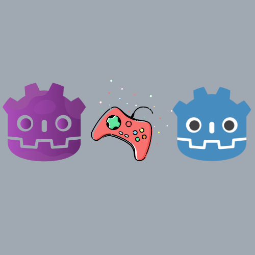

# MultiplayerExperiment

	

Welcome to MultiplayerExperiment, a Godot-based project exploring multiplayer functionalities. While still a work in progress, this repository demonstrates the potential of multiplayer implementation in Godot, despite some existing bugs and crashes.

## Video

https://github.com/user-attachments/assets/e368dd21-81eb-4cd8-aa55-1d2c5f98b673

## Playing
To play the game, 
1. Open the project in the Godot editor and run it
2. Either host the server, or join a game. If you are hosting, just press the "Host Game" button. If you are joining, enter the IP address of the host (you can check the IP address of the host machine by running `hostname -I`).
3. You can send and receive messages from other players, using the chat box.
4. Whenever you are ready, press "Esc" to toggle focus on the chat box, then press "Space". When everyone is ready, the game will start.
5. Move with the WASD keys.
